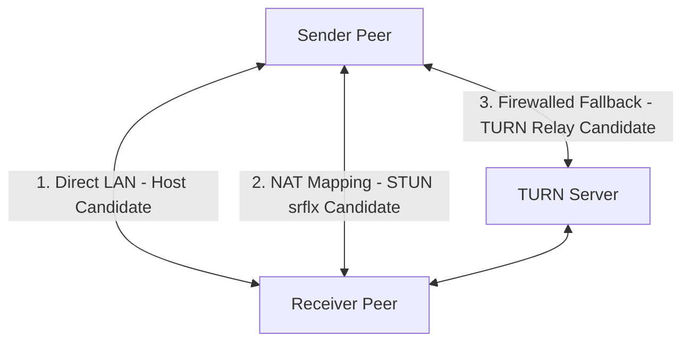

# NAT Traversal & ICE Strategy Specification (Shipri)

WebRTC establishes direct peer-to-peer connections. However, in the real world, firewalls, routers, and Network Address Translators (NAT) block direct incoming connections. This document specifies the infrastructure and configuration needed to achieve a 95%+ connection success rate using STUN and TURN servers.

---

## 1. Network Topologies & Connection Paths

When establishing a connection, the ICE (Interactive Connectivity Establishment) framework gathers three types of candidate addresses:

1. **Host Candidates**: Local network IP addresses (e.g., `192.168.1.50`). Used if both peers are in the same local area network (LAN).
2. **Server Reflexive (srflx) Candidates**: The peer's public IP and port mapped by their router (discovered via a STUN server). Used for direct P2P connections across the internet (works for Cone NATs).
3. **Relay Candidates**: The IP of a relay server (TURN server) that forwards traffic when direct P2P is impossible (typically when both peers are behind Symmetric NAT, which is standard in 4G/5G mobile carriers and corporate firewalls).



---

## 2. Infrastructure Setup: STUN vs. TURN

### 2.1. STUN Configuration (Public & Free)
STUN servers are stateless and consume virtually zero bandwidth since they only return the requester's public IP/port. We will use public Google STUN servers:
* `stun:stun.l.google.com:19302`
* `stun:stun1.l.google.com:19302`

The Backend POC uses only these public STUN servers. It does not return TURN URLs, TURN usernames, TURN credentials, or any shared TURN secret.

### 2.2. TURN Configuration (Self-Hosted via Coturn)
Since Shipri transfers large files, commercial TURN services can quickly become expensive. We will self-host **Coturn** (the industry-standard open-source TURN server) on a cloud instance with a high bandwidth quota.

#### Critical Firewall Bypass (Port 443 / TLS)
Many corporate and public Wi-Fi networks block UDP traffic entirely and restrict TCP to standard web ports (80/443).
* **Strategy**: Run Coturn on port **443** using TCP and TLS (TURNS). To firewalls, this traffic looks identical to secure HTTPS traffic, allowing files to be transferred even in highly restricted corporate environments.
* **Port ownership rule**: `shipri.app:443` is reserved for Caddy HTTPS/WSS. Coturn TURNS on `443` must use a separate endpoint such as `turn.shipri.app:443` on a separate public IP, or another explicitly documented topology that avoids binding Caddy and Coturn to the same `IP:443`.

---

## 3. Environment-Driven ICE & Dynamic TURN Authentication Contract

Dynamic TURN authentication is a full-backend production extension (`BE-4`), while the Backend POC (`REQUIRE_TURN=false` with unset `TURN_URLS`/`TURN_SHARED_SECRET`) returns STUN-only `iceServers` as defined in `signaling_protocol_spec.md` Section `3.5`.

To prevent unauthorized parties from using the Coturn instance as an open relay, production implements time-limited TURN REST credentials compatible with Coturn `use-auth-secret` and driven entirely by validated runtime environment variables.

### 3.1. Environment Configuration Contract

```typescript
// Validated environment configuration consumed by the signaling ICE provider.
interface IceRuntimeConfig {
  // Required comma-separated STUN endpoints (e.g., "stun:stun.l.google.com:19302,stun:stun1.l.google.com:19302").
  stunUrls: string[];

  // Full-backend comma-separated TURN/TURNS endpoints (e.g., turn:turn.shipri.app:3478?transport=udp,...).
  turnUrls: string[];

  // Shared HMAC-SHA1 secret matching Coturn static-auth-secret. Never serialized to clients or logged.
  turnSharedSecret?: string;

  // Ephemeral credential validity window in seconds (default 7200 = 2 hours; bounded 60..86400).
  turnCredentialTtlSeconds: number;

  // False in POC STUN-only mode; true in full backend so missing/invalid TURN config fails closed.
  requireTurn: boolean;
}
```

### 3.2. On-Demand Credential Derivation and Failure Handling

1. **Authorized Membership Required**: Only an active member of a non-expired room (`room:create` or `room:join` completed; `socketRooms` matches `roomId`) may invoke `ice:get`. Non-members receive `UNAUTHORIZED`; invalid room format receives `INVALID_ROOM_ID`; absent or expired rooms receive `ROOM_NOT_FOUND`.
2. **Ephemeral Username and HMAC-SHA1 Credential**: When `turnUrls.length > 0` and `turnSharedSecret` is configured:
   * `expiryEpoch = Math.floor(Date.now() / 1000) + turnCredentialTtlSeconds`
   * `opaqueTag = crypto.randomBytes(8).toString('hex')` (avoids exposing raw internal `socketId` or IP)
   * `username = "${expiryEpoch}:${opaqueTag}"`
   * `credential = crypto.createHmac('sha1', turnSharedSecret).update(username).digest('base64')`
3. **Fail-Closed Production Error Handling**: If `REQUIRE_TURN=true` and `TURN_URLS` is empty or `TURN_SHARED_SECRET` is missing/empty (or if no valid STUN/TURN entries exist in POC mode), the server emits `room:error` with `code: 'SERVER_BUSY'` and a generic message, without leaking environment values, secrets, or stack traces.

### 3.3. Production `ice:get` / `ice:credentials` TypeScript & JSON Contract

```typescript
interface IceGetPayload {
  roomId: RoomId;
}

interface IceServer {
  urls: string | string[];
  username?: string;
  credential?: string;
}

interface IceCredentialsPayload {
  roomId: RoomId;
  iceServers: IceServer[];
}
```

Client request (`ice:get`):
```json
{
  "roomId": "ship-83a1"
}
```

Full backend server response (`ice:credentials`):
```json
{
  "roomId": "ship-83a1",
  "iceServers": [
    {
      "urls": [
        "stun:stun.l.google.com:19302",
        "stun:stun1.l.google.com:19302"
      ]
    },
    {
      "urls": [
        "turn:turn.shipri.app:3478?transport=udp",
        "turn:turn.shipri.app:3478?transport=tcp",
        "turns:turn.shipri.app:443?transport=tcp"
      ],
      "username": "1785239200:9f4c12a8e31b70d4",
      "credential": "computed_hmac_sha1_signature_base64"
    }
  ]
}
```

---

## 4. Coturn Configuration File Setup (`turnserver.conf`)

Below is the production-ready configuration blueprint for our Coturn instance:

```ini
# Listening Ports
listening-port=3478
tls-listening-port=443

# Network bindings
listening-ip=0.0.0.0
external-ip=YOUR_SERVER_PUBLIC_IP

# Cryptography & Certificates (required for TLS/TURNS on turn.shipri.app:443)
cert=/etc/letsencrypt/live/turn.shipri.app/fullchain.pem
pkey=/etc/letsencrypt/live/turn.shipri.app/privkey.pem

# Security & Authentication
fingerprint
lt-cred-mech
use-auth-secret
static-auth-secret=YOUR_STRONG_SHARED_SECRET
realm=turn.shipri.app

# Performance Optimizations
# Disable legacy protocols to reduce attack surface
no-sslv3
no-tlsv1
no-tlsv1_1

# Logging & Performance limits
total-quota=1200
user-quota=2
syslog
```

`total-quota` and `user-quota` must be sized for the deployment budget. Avoid unlimited quotas on public deployments unless there is an external bandwidth limiter.

---

## 5. ICE Connection Optimization Rules for Clients

1. **Trickle ICE and Immediate SDP Forwarding**: Clients must forward SDP offers and answers via `signal:forward` immediately after `setLocalDescription()` succeeds without waiting for ICE candidate gathering (`iceGatheringState === "complete"`) to finish. Both peers trickle local candidates via `signal:forward` as `icecandidate` events produce them.
2. **Early Remote Candidate Queuing**: Inbound ICE candidates that arrive before the matching `setRemoteDescription()` resolves must be queued in arrival order and applied via `addIceCandidate()` immediately after `setRemoteDescription()` succeeds.
3. **Five-Second ICE Candidate Gathering Bound**: Sometimes ICE gathering stalls while probing disconnected or unresponsive network interfaces. Clients enforce a **5-second (`5000ms`)** diagnostic bound on ICE candidate gathering: exceeding 5 seconds surfaces a stalled-gathering diagnostic notice in the UI without delaying an otherwise valid initial SDP offer or answer, and late candidates produced afterward continue trickling while the active negotiation generation remains open.
4. **Generation-Scoped ICE Session Cleanup**: Each negotiation session binds inbound and outbound ICE candidates to the active remote `peerId` and monotonic negotiation generation. On `peer:left`, `room:leave`, or socket `disconnect`, clients close the active `RTCPeerConnection` and `RTCDataChannel`, clear gathering timers, invalidate the previous generation, and ignore late candidates from replaced sessions.
5. **WebRTC Peer Connection Options**:
   ```javascript
   const peerConnection = new RTCPeerConnection({
     iceServers: receivedIceServers,
     iceTransportPolicy: "all" // Allows fallback to TURN when relaying is needed
   });
   ```
6. **Bandwidth Warning**: If the selected ICE candidate is a `relay` candidate, notify the user in the UI: *"Direct P2P connection could not be established. Relaying via secure server (speed may be reduced)."*
7. **Prototype Transport Policy and Candidate-Pair Diagnostics (`FP-5`)**: The Part 3 frontend prototype adds selectable `iceTransportPolicy` modes (`"all"` for direct-preferred and `"relay"` for forced-TURN verification), summarizes gathered candidate types (`host`, `srflx`, `relay`), inspects `RTCPeerConnection.getStats()` to report whether the selected active candidate pair is `direct` or `relay`, displays the bandwidth notice above when relayed, and surfaces `SERVER_BUSY` or ICE/TURN connectivity errors cleanly without ever logging `TURN_SHARED_SECRET`, raw TURN credentials, or raw candidate IP details.
