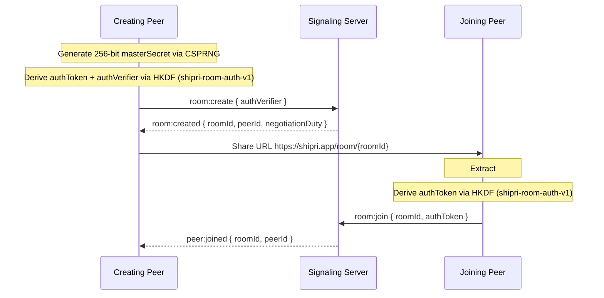

# Security & End-to-End Encryption (E2EE) Specification (Shipri)

This document defines the frozen Zero-Knowledge security and cryptographic contract (`FF-0`) for Project Shipri. Neither the signaling server, internet service providers (ISPs), nor any third-party intermediary can inspect filenames, file sizes, file-board state, download requests, or binary file contents.

All binary-to-text fields in JSON schemas use unpadded `base64url` (`RFC 4648` Section 5, matching `/^[A-Za-z0-9_-]+$/`). TypeScript notation below is a documentation convention only; the implementation remains JavaScript.

---

## 1. Threat Model & Security Goals

### 1.1. Assumptions & Trust Boundaries
* **Signaling Server**: Deemed **untrusted**. The system remains confidential and tamper-evident even if the signaling server is compromised or controlled by an adversary.
* **Backend Exclusion Boundary**: Socket.IO and `server/` never receive, store, inspect, or log `#key=` fragments, master secrets, E2EE keys, shared file-board state, `FILE_ADVERTISE`/`FILE_REMOVE` payloads, plaintext file metadata, download requests, `FLOW_CREDIT`, transfer progress, or binary file chunks.
* **Network Path**: Deemed **untrusted**. Standard WebRTC uses DTLS-SRTP for transport encryption; Shipri adds an independent application-level AES-256-GCM E2EE layer over both `shipri-control` and `shipri-binary`.
* **Client Browsers (Room Peers)**: Deemed **trusted**. Code executing in both user browsers runs in secure, isolated browser sandboxes.

### 1.2. Security Targets
1. **Confidentiality**: Only the two authorized room peers possessing the URL-fragment master secret can decrypt file-board metadata, control messages, and file contents.
2. **Integrity & Domain Binding**: Any tampering, replay across rooms/transfers/epochs, or header modification is detected immediately by AES-GCM authentication tags and fails closed on the affected message or transfer.
3. **Zero Metadata Leakage**: Plaintext filename, size, MIME type, checksum, board membership, and transfer progress never enter Socket.IO, HTTP requests, URL paths/queries, or application logs.

---

## 2. Key Generation, Distribution & Lifecycle (URL Fragment Method)

The fundamental pillar of Shipri's Zero-Knowledge architecture is that the 256-bit room master secret is **never transmitted to any server**, including our own.



### 2.1. Master Secret Generation & Stable Member Identity
The creating peer generates a cryptographically secure, random 256-bit master secret using the Web Crypto API:

```javascript
const masterKeyBytes = crypto.getRandomValues(new Uint8Array(32));
// Unpadded base64url (43 characters for 32 bytes)
const keyStringBase64Url = encodeBase64Url(masterKeyBytes);
```

Each peer also generates a persistent room-session `memberId` (16 random CSPRNG bytes, encoded as 22-char unpadded `base64url`) stored in memory and tab-scoped `sessionStorage` alongside the room session. Unlike ephemeral Socket.IO `socket.id` values or `offerer`/`answerer` negotiation duties (which can flip across reconnects), `memberId` stays constant across reconnects and uniquely defines protocol-stable transfer direction tokens.

### 2.2. URL Hash Fragment (`#key=`) & Reload Recovery Lifecycle
The share link places the master secret strictly in the URL fragment:
`https://shipri.app/room/ship-83a1#key=<43-char-base64url-master-secret>`

1. **Fragment-Only Transport**: Per RFC 3986, URL fragments stay strictly client-side and are never sent in HTTP requests, WebSocket handshakes, or `Referer` headers. No authorization token or key material may ever appear in URL paths or query parameters.
2. **Immediate Address-Bar Cleanup**: Immediately after extracting `#key=` on room entry, the client removes the fragment with:
   `window.history.replaceState(null, '', window.location.pathname);`
3. **Tab-Scoped Reload Recovery (`sessionStorage`)**: To survive same-tab reloads (F5) without re-exposing `#key=` in the URL, the client caches `{ masterKeyBase64Url, memberId }` in tab-scoped `sessionStorage` keyed by `shipri:room-session:${roomId}`.
4. **Explicit Wipe**: The `sessionStorage` entry and in-memory key references MUST be cleared on intentional `room:leave`, terminal room errors (`ROOM_NOT_FOUND`, `UNAUTHORIZED`, `ROOM_FULL`), or explicit session reset.
5. **Fail-Closed Validation**: Missing or non-32-byte malformed `#key=` values fail safely with user-facing error guidance without logging the raw fragment.

### 2.3. Domain-Separated HKDF-SHA256 Key Schedule

All cryptographic secrets derive from the single 256-bit `masterKeyBytes` via Web Crypto `HKDF-SHA256` with disjoint salt/info domains:

| Domain Purpose | HKDF Salt | HKDF Info | Output Type & Usage |
| :--- | :--- | :--- | :--- |
| Room Signaling Authorization | `utf8("shipri-room-auth-salt-v1")` | `utf8("shipri-room-auth-v1")` | 256-bit `authToken` (`base64url`) + `SHA-256(utf8(authToken))` (`authVerifier`); implemented in `client/src/crypto/room-auth.js`, independent of `roomId` and disjoint from all E2EE AES-GCM keys. |
| File-Board Metadata Encryption | `utf8("shipri:${roomId}")` | `utf8("shipri-board-metadata-v1")` | 256-bit non-extractable `AES-GCM` key (`encrypt`, `decrypt`) for `FILE_ADVERTISE.encryptedMetadata`. |
| Authenticated Control Channel | `utf8("shipri:${roomId}")` | `utf8("shipri-control-v1")` | 256-bit non-extractable `AES-GCM` key (`encrypt`, `decrypt`) for `ControlEnvelope` AEAD on `shipri-control`. |
| Per-Transfer-Epoch Binary Chunks | `utf8("shipri:${roomId}")` | `utf8("shipri-file-chunks-v1:${transferId}:${direction}:${epoch}")` | 256-bit non-extractable `AES-GCM` key (`encrypt`, `decrypt`) unique to one `(roomId, transferId, direction, epoch)`. |

Where:
* `roomId`: canonical `ship-[a-f0-9]{4}` room identifier.
* `transferId`: 16-byte CSPRNG transfer identifier encoded as 22-char unpadded `base64url` (and raw 16 bytes in binary frame headers).
* `direction`: protocol-stable owner-to-downloader token `"${ownerMemberId}->${downloaderMemberId}"` (never derived from `socket.id` or `offerer`/`answerer`).
* `epoch`: unsigned 32-bit integer starting at `1`, strictly incremented (`epoch + 1`) on every resume attempt before any chunk index can be re-sent.

```typescript
type Base64Url = string; // Unpadded RFC 4648 base64url (/^[A-Za-z0-9_-]+$/)
type RoomId = `ship-${string}`;
type MemberId = Base64Url; // 16 random bytes (22 base64url chars)
type FileId = Base64Url; // 16 random bytes (22 base64url chars)
type TransferId = Base64Url; // 16 random bytes (22 base64url chars)
type TransferDirection = `${MemberId}->${MemberId}`; // ownerMemberId->downloaderMemberId
```

---

## 3. Authenticated Control Channel & Encrypted Metadata Schemas

### 3.1. Canonical `shipri-control-v1` AEAD Envelope
Every message transmitted on `shipri-control` MUST be wrapped in an authenticated `ControlEnvelope` encrypted with the `shipri-control-v1` AES-256-GCM key. Plaintext control messages are forbidden on the wire.

```typescript
interface ControlEnvelope {
  v: 1;
  senderMemberId: MemberId;
  iv: Base64Url; // 12-byte CSPRNG random IV (16 base64url chars), unique per message
  ciphertext: Base64Url; // AES-256-GCM(UTF-8 JSON ControlMessage) + 16-byte tag
}
```

* **Associated Data (AAD)**: `utf8("shipri-control-v1:${roomId}:${senderMemberId}")`.
* **IV Generation**: Fresh 12-byte CSPRNG random IV (`crypto.getRandomValues(new Uint8Array(12))`) per outbound control message.
* **Verification**: Receivers validate envelope fields, decode `iv` (must be exactly 12 bytes) and `ciphertext`, verify the AES-GCM tag with the bound AAD, and parse the decrypted UTF-8 JSON `ControlMessage`. Any decryption, AAD, or schema failure drops the message and fails closed without mutating state.

### 3.2. Canonical `FILE_ADVERTISE` Encrypted Metadata Schema
Inside the authenticated `ControlEnvelope`, `FILE_ADVERTISE` encrypts file metadata separately under the `shipri-board-metadata-v1` AES-256-GCM key using this single canonical unpadded `base64url` structure (synchronized verbatim with `p2p_data_protocol_spec.md`):

```typescript
interface PlaintextFileMetadata {
  fileName: string; // Sanitized display filename (1..255 UTF-8 chars)
  fileSize: number; // Non-negative safe integer byte length
  fileType: string; // MIME type or "" if unknown
  chunkSize: number; // Fixed 65536 bytes (64 KiB) for MVP
  totalChunks: number; // Math.ceil(fileSize / chunkSize), 0 for 0-byte files
  sha256?: Base64Url; // Optional digest if precomputed
}

interface EncryptedMetadataBlob {
  iv: Base64Url; // 12-byte CSPRNG random IV (16 base64url chars)
  ciphertext: Base64Url; // AES-256-GCM(UTF-8 JSON PlaintextFileMetadata) + 16-byte tag
}

interface FileAdvertiseMessage {
  type: 'FILE_ADVERTISE';
  payload: {
    fileId: FileId;
    encryptedMetadata: EncryptedMetadataBlob;
  };
}
```

* **Metadata AAD**: `utf8("shipri-board-metadata-v1:${roomId}:${fileId}")`, cryptographically binding encrypted metadata to both the room and the opaque `fileId`.
* **No Plaintext Leakage**: `PlaintextFileMetadata` exists only in local browser RAM before encryption and after local decryption on the remote peer.

---

## 4. Epoch-Safe Encrypted Binary Framing (`shipri-binary`)

Each binary message on `shipri-binary` carries a fixed 52-byte deterministic binary header followed immediately by the AES-256-GCM ciphertext (which ends with its 16-byte authentication tag).

### 4.1. Deterministic Binary Frame Header Layout (52 Bytes, Big-Endian)

| Offset | Size (Bytes) | Field | Encoding / Value |
| :--- | :--- | :--- | :--- |
| `0` | `4` | `magic` | ASCII `"SHP1"` (`0x53 0x48 0x50 0x31`) |
| `4` | `1` | `version` | `uint8` = `1` |
| `5` | `1` | `flags` | `uint8` (`0x00` normal chunk; `0x01` final chunk of file) |
| `6` | `1` | `directionCode` | `uint8` (`0x01` when `ownerMemberId < downloaderMemberId` lexicographically; `0x02` when `ownerMemberId > downloaderMemberId`) |
| `7` | `1` | `reserved` | `uint8` = `0x00` (must be zero; non-zero fails closed) |
| `8` | `16` | `transferId` | Raw 16-byte `transferId` |
| `24` | `16` | `fileId` | Raw 16-byte `fileId` |
| `40` | `4` | `epoch` | `uint32` big-endian (`>= 1`) |
| `44` | `4` | `chunkIndex` | `uint32` big-endian (`0 .. totalChunks - 1`) |
| `48` | `4` | `plaintextLength` | `uint32` big-endian (`1 .. 65536`, or `0` only for a 0-byte file sentinel if ever framed) |
| `52` | `plaintextLength + 16` | `ciphertextAndTag` | AES-256-GCM ciphertext + 16-byte authentication tag |

* **Header as AES-GCM AAD**: The exact 52-byte header `Uint8Array(frameBuffer, 0, 52)` is passed verbatim as `additionalData` to `crypto.subtle.encrypt` and `crypto.subtle.decrypt`. Any modification to `transferId`, `fileId`, `epoch`, `chunkIndex`, `directionCode`, `flags`, or `plaintextLength` immediately causes GCM verification failure.
* **Total Wire Overhead**: `52` bytes header + `16` bytes GCM tag = `68` bytes per 64 KiB chunk (`~0.10%` overhead).

### 4.2. Nonce / IV Construction & Nonce-Reuse Prevention
Within each unique `(roomId, transferId, direction, epoch)` HKDF chunk key:

```javascript
function buildChunkIv(chunkIndex) {
  if (!Number.isInteger(chunkIndex) || chunkIndex < 0 || chunkIndex > 0xffffffff) {
    throw new RangeError('chunkIndex must be a valid uint32.');
  }
  const buffer = new ArrayBuffer(12);
  const view = new DataView(buffer);
  // First 4 bytes remain 0x00000000; last 8 bytes encode chunkIndex big-endian.
  view.setBigUint64(4, BigInt(chunkIndex), false);
  return new Uint8Array(buffer);
}
```

* **Zero Nonce Reuse Across Transfers**: Simultaneous transfers in the same or opposite directions have distinct `transferId` and/or `direction` values, yielding independent HKDF keys even when both encrypt `chunkIndex = 0`.
* **Zero Nonce Reuse Across Resumes**: Before a resumed transfer re-sends any chunk index, `RESUME_REQUEST` / `RESUME_ACCEPTED` strictly increments `epoch` (`newEpoch > previousEpoch`), deriving a brand-new HKDF chunk key.
* **Fail-Closed Verification**: The downloader validates frame length (`byteLength === 52 + plaintextLength + 16`), magic, version, reserved byte, `transferId`, `fileId`, `directionCode`, active `epoch`, expected sequential `chunkIndex`, and credit boundary (`(chunkIndex * CHUNK_SIZE_BYTES + plaintextLength) <= maxPlaintextOffsetExclusive`) before decrypting and passing the plaintext buffer to persistence.

---

## 5. Browser Execution & Web Worker Cryptographic Constraints

1. **Main-Thread Ownership**: `RTCPeerConnection` is a Window API and stays on the main thread alongside Socket.IO signaling and the tested main-thread `RTCDataChannel` compatibility baseline (`p2p_data_protocol_spec.md` Section `7`).
2. **Web Worker Crypto & Framing**: Owner-side `Blob.slice()` + AES-GCM encryption + 52-byte framing and downloader-side frame validation + AES-GCM decryption run inside dedicated Web Workers, exchanging chunk `ArrayBuffer`s via zero-copy transferable `postMessage(msg, [buffer])` handoffs.
3. **Worker-Owned `RTCDataChannel`**: Treated strictly as an optional future optimization until verified across the supported browser matrix; never assumed as a prerequisite.
4. **Secure Contexts Required**: `crypto.subtle` is available only in Secure Contexts (`https:` or `localhost`). Shipri refuses E2EE room operations over insecure plain HTTP origins.

---

## 6. References

* [RFC 4648: Base16, Base32, and Base64 Data Encodings (`base64url`)](https://www.rfc-editor.org/rfc/rfc4648.html)
* [RFC 5869: HKDF](https://www.rfc-editor.org/rfc/rfc5869.html)
* [MDN Web Crypto API `AesGcmParams`](https://developer.mozilla.org/en-US/docs/Web/API/AesGcmParams)
* [NIST SP 800-38D (AES-GCM)](https://nvlpubs.nist.gov/nistpubs/legacy/sp/nistspecialpublication800-38d.pdf)
