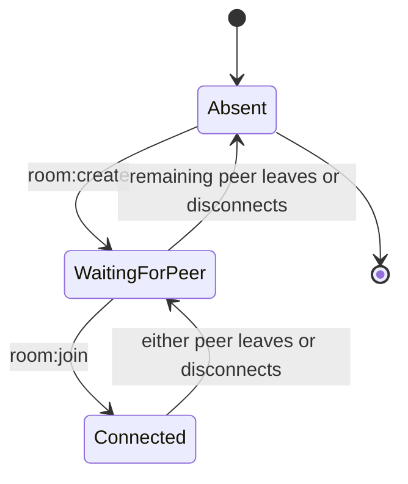

# Signaling Protocol & Room Logic Specification (Shipri)

The Socket.IO signaling server coordinates two browser peers and relays WebRTC negotiation data. It never receives file-board state, plaintext file metadata, file requests, file contents, or transfer progress.

---

## 1. Canonical Peer Model

* A room contains zero, one, or two active peers. Production authorization is defined separately from POC socket membership.
* Both connected members are equal product peers and may publish local files or request remote files.
* `creator` and `joiner` describe room-entry history only.
* The creator is the deterministic initial WebRTC offerer and the joiner is the initial answerer. These negotiation duties never define transfer direction.
* The base room lifecycle keeps a room available while at least one peer is connected. Empty-room cleanup is immediate: when the last active peer leaves or disconnects, the room is deleted.



---

## 2. Room Rules

1. Room capacity is exactly two active connections.
2. Room IDs use `ship-[a-f0-9]{4}`, generated via Node.js `crypto.randomBytes(2)` and verified unique against active rooms before allocation.
3. Production room authorization is independent from the short room ID.
4. Both members may relay signaling data only to the other active member.
5. A third connection receives `ROOM_FULL`.
6. An empty room is always deleted immediately. Production idle and maximum lifetime rules may delete non-empty rooms earlier.
7. In the Backend POC, one socket may have at most one active Shipri room membership.

### 2.1. Backend POC Lifecycle

`Absent` means no application room record exists. `WaitingForPeer` contains exactly one active peer, and `Connected` contains exactly two active peers.

| Current state | Trigger | Next state | Observable result |
| :--- | :--- | :--- | :--- |
| `Absent` | An unaffiliated socket emits valid `room:create`. | `WaitingForPeer` | Create the room and emit `room:created` to the creator with `offerer` duty. |
| `WaitingForPeer` | A different unaffiliated socket emits valid `room:join`. | `Connected` | Emit `room:joined` with `answerer` duty to the joiner and `peer:joined` to the existing peer. |
| `Connected` | A third unaffiliated socket emits valid `room:join`. | `Connected` | Reject the joiner with `ROOM_FULL`; room membership does not change. |
| `Connected` | Either member emits valid `room:leave`. | `WaitingForPeer` | Remove the leaving peer and emit `peer:left` with `reason: "leave"` to the remaining peer. |
| `Connected` | Either member disconnects. | `WaitingForPeer` | Remove the disconnected peer and emit `peer:left` with `reason: "disconnect"` to the remaining peer. |
| `WaitingForPeer` | The only member emits valid `room:leave`. | `Absent` | Remove the peer and delete the empty room. No `peer:left` event is emitted because no peer remains. |
| `WaitingForPeer` | The only member disconnects. | `Absent` | Delete the empty room. No `peer:left` event is emitted because no peer remains. |

After either peer leaves a connected room, the remaining peer becomes the offerer for the next replacement peer. A replacement joins through the same `WaitingForPeer` to `Connected` transition and receives `answerer` duty.

Empty-room cleanup is shared by the Backend POC and production lifecycle: when the last active peer leaves or disconnects, the room is deleted immediately.

The Backend POC does not expire a waiting or connected room by TTL and does not apply rate limits, maximum room counts, or production access tokens. Production applies the full backend authorization, TTL, capacity, and rate-limit contract in Subsection `2.2` below. Socket.IO automatically removes a disconnected socket from adapter rooms; the backend must still remove its application room membership and notify any remaining peer during disconnect cleanup.

### 2.2. Full Backend Production Contract & Migration (`BE-0`)

Full backend development (`backend_development_plan.md`) preserves the accepted Backend POC lifecycle (`WaitingForPeer`, `Connected`, `Absent`), equal-peer model, `offerer`/`answerer` negotiation duties, `room:leave`, `peer:left`, `signal:forward`, `signal:receive`, `ice:get`, `ice:credentials`, and `room:error` semantics without breaking the frontend prototype, except for three explicit production extensions:

1. **Security-Driven Room Authorization Migration (`room:create` and `room:join`)**: Because `ship-[a-f0-9]{4}` has only 65,536 values, an unauthenticated `room:join` allows room enumeration and second-peer slot denial of service (`architectural_audit.md` Sections `1.2` and `1.3`). Production defaults `REQUIRE_ROOM_AUTH=true`, requiring `authVerifier` on `room:create` and `authToken` on `room:join`. An explicit `REQUIRE_ROOM_AUTH=false` compatibility toggle may remain available only for non-production local or POC regression tests (`NODE_ENV=production` must reject `REQUIRE_ROOM_AUTH=false` at startup).
2. **Dynamic TURN Entries in `ice:credentials`**: `ice:credentials` retains the POC `IceCredentialsPayload` shape while adding short-lived HMAC-SHA1 TURN entries (`username`, `credential`) alongside STUN endpoints (`nat_traversal_strategy.md` Section `3`).
3. **Abuse-Control Error & Operational Limits**: `room:error` adds `RATE_LIMITED`, and `activeRooms` enforces `MAX_ROOMS`, `ROOM_IDLE_TTL_MS`, `ROOM_MAX_LIFETIME_MS`, and per-IP `room:create` rate limiting.

#### 2.2.1. HKDF-Separated Room Authorization Model

Shipri separates room access control from both the short public `roomId` and E2EE file/control encryption keys while keeping all secrets out of HTTP paths, query strings, proxy access logs, and `Referer` headers:

* **URL Fragment Boundary**: Share links use `https://shipri.app/room/<roomId>#key=<masterKeyBase64Url>`. Per RFC 3986, the `#key=` fragment is never transmitted in HTTP requests or WebSocket handshake headers (`security_e2ee_spec.md` Section `2.3`).
* **One-Way HKDF Domain Derivation**: Before calling `room:create` (before `roomId` exists), the creating client derives a 256-bit (32-byte) room authorization secret from the 256-bit CSPRNG `#key=` master secret (`masterKeyBytes`) using Web Crypto HKDF-SHA256:
  * `ikm`: `masterKeyBytes` (32 bytes)
  * `salt`: UTF-8 bytes of `"shipri-room-auth-salt-v1"` (constant domain salt independent of `roomId`)
  * `info`: UTF-8 bytes of `"shipri-room-auth-v1"`
  * `length`: `256` bits (`32` bytes)
* **Cryptographic Separation from E2EE Keys**: `security_e2ee_spec.md` Section `2.2` derives `shipri-board-metadata-v1`, `shipri-control-v1`, and `shipri-file-chunks-v1` AES-GCM keys using per-room `salt: "shipri:${roomId}"` and distinct `info` labels. Because HKDF-SHA256 is one-way with disjoint `salt` and `info` inputs, exposing `authToken` or `authVerifier` to the untrusted signaling server reveals neither `masterKeyBytes` nor any E2EE key, and remains mathematically independent of `ship-[a-f0-9]{4}`.
* **Client-Side Diagnostic Mode (`FP-6`)**: During Part 3 prototype testing before E2EE is implemented (`frontend_prototype_plan.md` Section `6`), the diagnostic client generates an independent 32-byte CSPRNG `authToken` (never claiming E2EE) or lets a tester override `authToken` manually to exercise authorization failures.
* **Verifier Hashing & Constant-Time Comparison**:
  * `authToken` is encoded as unpadded `base64url` (`43` characters matching `/^[A-Za-z0-9_-]{43}$/` for standard 32-byte tokens; server validation accepts non-empty strings from `1` to `256` characters on `room:join` so diagnostic wrong-token inputs trigger `UNAUTHORIZED` rather than `INVALID_PAYLOAD`).
  * `authVerifier` is the unpadded `base64url` encoding of `SHA-256(utf8(authToken))` (`43` characters matching `/^[A-Za-z0-9_-]{43}$/`, decoding to exactly `32` bytes).
  * On `room:create`, the client transmits `{ authVerifier }`, never the raw `authToken`. The server decodes `authVerifier` into a 32-byte `Buffer` stored only in `Room.authVerifierHash` (or `null` only when `REQUIRE_ROOM_AUTH=false` and `authVerifier` was omitted).
  * On `room:join`, when `room.authVerifierHash !== null`, the server computes `candidateHash = crypto.createHash('sha256').update(authToken, 'utf8').digest()` (32 bytes) and compares `crypto.timingSafeEqual(candidateHash, room.authVerifierHash)`. Hashing `authToken` upon join guarantees constant-time 32-byte comparison and ensures even read access to `Room.authVerifierHash` in server memory does not reveal a usable `authToken`.

#### 2.2.2. Frozen Capacity, TTL, Rate-Limit, and Cleanup Defaults

| Parameter | Production Default | Behavior & Enforcement Rule |
| :--- | :--- | :--- |
| `REQUIRE_ROOM_AUTH` | `true` | Requires `authVerifier` on `room:create` and `authToken` on `room:join`. Startup fails if set to `false` when `NODE_ENV=production`. |
| `MAX_ROOMS` | `5000` | Hard cap on concurrent entries in `activeRooms`. After purging expired rooms, `room:create` at or above `MAX_ROOMS` fails with `SERVER_BUSY`. |
| `ROOM_IDLE_TTL_MS` | `1800000` (30 minutes) | Waiting/idle room expiry window. Initial `expiresAt = Math.min(now + ROOM_IDLE_TTL_MS, maxExpiresAt)`. Refreshed on valid `room:join`, `room:leave` (leaving 1 peer), `disconnect` (leaving 1 peer), `signal:forward`, and `ice:get`. |
| `ROOM_MAX_LIFETIME_MS` | `14400000` (4 hours) | Hard cap from creation: `maxExpiresAt = createdAt + ROOM_MAX_LIFETIME_MS`. Never extended by room activity. |
| `ROOM_CLEANUP_INTERVAL_MS` | `60000` (60 seconds) | Periodic sweep interval removing rooms where `now >= room.expiresAt || now >= room.maxExpiresAt`. Lazy expiry checks also run on room lookup before enforcing auth or capacity. |
| `ROOM_CREATE_RATE_LIMIT_MAX` | `10` | Maximum `room:create` attempts per resolved client IP within `ROOM_CREATE_RATE_LIMIT_WINDOW_MS`. Exceeding emits `room:error` with `RATE_LIMITED`. |
| `ROOM_CREATE_RATE_LIMIT_WINDOW_MS` | `60000` (60 seconds) | Sliding or fixed rate-limit window per resolved client IP for `room:create`. |
| `TRUST_PROXY` | `false` | Controls whether Express and Socket.IO IP extraction trusts `X-Forwarded-For`. Direct deployments leave `TRUST_PROXY=false` (ignoring spoofable `X-Forwarded-For`); deployments behind `nginx-proxy` or Caddy configure explicit hop/proxy trust (`1` or trusted proxy spec). |

* **Disconnect Cleanup**: On socket `disconnect`, the server resolves membership in O(1) via `socketRooms`. If the departing socket leaves 1 peer in the room, the server removes the departing socket from `room.peers`, `socketRooms`, and the Socket.IO room, emits `peer:left` (`{ roomId, peerId, reason: 'disconnect' }`) to the remaining peer (which becomes `offerer` for any replacement join), and refreshes `lastActivityAt` / `expiresAt` (`Math.min(now + ROOM_IDLE_TTL_MS, room.maxExpiresAt)`). If 0 peers remain, the server deletes the room immediately from `activeRooms` without emitting `peer:left`.
* **TTL & Hard-Lifetime Expiry Cleanup**: When a room expires (`now >= room.expiresAt || now >= room.maxExpiresAt`) during either lazy lookup or the periodic cleanup sweep, the server emits `room:error` (`{ roomId, code: 'ROOM_NOT_FOUND', message: 'Room does not exist or has expired.' }`) to any connected socket(s) still in `room.peers`, clears their `socketRooms` entries, removes them from the Socket.IO room (`socket.leave(roomId)`), and deletes the room from `activeRooms`. Subsequent operations against that `roomId` return `ROOM_NOT_FOUND`. Once two peers have established a P2P WebRTC `RTCDataChannel`, ongoing P2P traffic does not traverse the signaling server and is unaffected by signaling expiry unless a peer reconnects or calls `ice:get`.

---

## 3. Socket.IO Events

This section is the canonical Socket.IO contract. Examples use an `{ "event": "...", "payload": ... }` envelope for documentation clarity; actual Socket.IO clients emit the event name with the payload object.

All payloads use `roomId` in camelCase whenever a room identifier is present. The Backend POC implements the baseline contract with in-memory rooms, socket-membership validation, development STUN-only ICE configuration, and `REQUIRE_ROOM_AUTH=false`. Full backend production (`BE-0` through `BE-7`) enables HKDF-separated room authorization (`REQUIRE_ROOM_AUTH=true`), room TTL and max lifetime, per-IP rate limiting, maximum active room capacity (`MAX_ROOMS=5000`), and time-limited HMAC-SHA1 TURN credentials without changing the semantics of `room:created`, `room:joined`, `peer:joined`, `room:leave`, `peer:left`, `signal:forward`, `signal:receive`, or `ice:get`.

The schema declarations below use TypeScript notation for readability only. The current implementation remains JavaScript.

Shared schema aliases:

```typescript
// Canonical short room identifier visible to both browser peers.
type RoomId = `ship-${string}`; // Must match ship-[a-f0-9]{4}.

// Backend-generated peer identifier. Clients must treat it as opaque.
type PeerId = string; // Opaque to clients.

// Base64url-encoded 32-byte SHA-256 digest of authToken (43 unpadded chars: /^[A-Za-z0-9_-]{43}$/).
type RoomAuthVerifier = string;

// Client-derived HKDF room authorization token (43-char base64url in E2EE mode; 1..256 chars accepted for validation).
type RoomAuthToken = string;

// Deterministic WebRTC offer/answer duty for the initial negotiation only.
type NegotiationDuty = 'offerer' | 'answerer';

// Reason sent to the remaining peer when the other peer leaves the room.
type PeerLeftReason = 'leave' | 'disconnect';

// JSON-compatible value used for opaque WebRTC signaling payloads.
type JsonValue = null | boolean | number | string | JsonValue[] | { [key: string]: JsonValue };

// SDP or ICE candidate data passed through without backend inspection.
type SignalData = { [key: string]: JsonValue }; // Opaque WebRTC signaling data.

// Browser RTCPeerConnection ICE server entry.
type IceServer = {
  // STUN or TURN URL, or a browser-supported list of URLs.
  urls: string | string[];

  // Time-limited TURN username (`${expiresAt}:${opaqueRoomPeerTag}`). Omitted for STUN-only entries.
  username?: string;

  // Ephemeral HMAC-SHA1 TURN credential computed from TURN_SHARED_SECRET. Omitted for STUN-only entries.
  credential?: string;
};
```

### 3.1. Create Room

Client to server (Full Backend Production with `REQUIRE_ROOM_AUTH=true`):

```json
{
  "event": "room:create",
  "payload": {
    "authVerifier": "base64url_43_char_sha256_digest_of_room_auth_token"
  }
}
```

Client to server (Backend POC compatibility mode when `REQUIRE_ROOM_AUTH=false`):

```json
{ "event": "room:create", "payload": {} }
```

Server to creating client:

```json
{
  "event": "room:created",
  "payload": {
    "roomId": "ship-83a1",
    "peerId": "opaque_peer_id",
    "negotiationDuty": "offerer"
  }
}
```

Schema:

```typescript
// Request payload to create a new room for the emitting socket.
// Production (REQUIRE_ROOM_AUTH=true) requires `authVerifier`; `{}` is permitted only when REQUIRE_ROOM_AUTH=false.
interface RoomCreatePayload {
  // Unpadded base64url SHA-256 digest of the client's roomAuthToken (32 bytes / 43 chars).
  authVerifier?: RoomAuthVerifier;
}

// Successful room creation response sent only to the creating peer.
interface RoomCreatedPayload {
  // Newly allocated canonical room ID.
  roomId: RoomId;

  // Opaque identifier assigned to the creating peer.
  peerId: PeerId;

  // Creator starts as the deterministic initial WebRTC offerer.
  negotiationDuty: 'offerer';
}
```

### 3.2. Join Room

Client to server (Full Backend Production with `REQUIRE_ROOM_AUTH=true`):

```json
{
  "event": "room:join",
  "payload": {
    "roomId": "ship-83a1",
    "authToken": "base64url_43_char_derived_room_auth_token"
  }
}
```

Client to server (Backend POC compatibility mode when `REQUIRE_ROOM_AUTH=false` and room has no `authVerifierHash`):

```json
{
  "event": "room:join",
  "payload": {
    "roomId": "ship-83a1"
  }
}
```

Server to joining client:

```json
{
  "event": "room:joined",
  "payload": {
    "roomId": "ship-83a1",
    "peerId": "opaque_peer_id",
    "negotiationDuty": "answerer"
  }
}
```

Server to existing room member:

```json
{
  "event": "peer:joined",
  "payload": {
    "roomId": "ship-83a1",
    "peerId": "opaque_peer_id"
  }
}
```

Schema:

```typescript
// Request payload used by the second peer to join an existing room.
interface RoomJoinPayload {
  // Canonical room ID received out of band from the creator.
  roomId: RoomId;

  // HKDF-derived roomAuthToken (or diagnostic token in prototype FP-6).
  // Required whenever REQUIRE_ROOM_AUTH=true or the room was created with authVerifier.
  authToken?: RoomAuthToken;
}

// Successful join response sent only to the joining peer.
interface RoomJoinedPayload {
  // Joined room ID.
  roomId: RoomId;

  // Opaque identifier assigned to the joining peer.
  peerId: PeerId;

  // Joiner starts as the deterministic initial WebRTC answerer.
  negotiationDuty: 'answerer';
}

// Notification sent to the existing peer after another peer joins.
interface PeerJoinedPayload {
  // Room where the new peer joined.
  roomId: RoomId;

  // Opaque identifier for the peer that just joined.
  peerId: PeerId;
}
```

### 3.3. Leave and Disconnect

Either peer may emit `room:leave`.

Client to server:

```json
{
  "event": "room:leave",
  "payload": {
    "roomId": "ship-83a1"
  }
}
```

Server to remaining room member:

```json
{
  "event": "peer:left",
  "payload": {
    "roomId": "ship-83a1",
    "peerId": "opaque_peer_id",
    "reason": "leave"
  }
}
```

Disconnect uses the same `peer:left` event with `reason: "disconnect"`. The remaining peer stays in the room and becomes the offerer for a future replacement connection.

Schema:

```typescript
// Request payload used by either active peer to leave intentionally.
interface RoomLeavePayload {
  // Room the emitting peer wants to leave.
  roomId: RoomId;
}

// Notification sent to the peer that remains in the room.
interface PeerLeftPayload {
  // Room where the peer departure happened.
  roomId: RoomId;

  // Opaque identifier for the peer that left or disconnected.
  peerId: PeerId;

  // Whether the peer explicitly left or the socket disconnected.
  reason: PeerLeftReason;
}
```

### 3.4. Signal Relay

Either room member emits `signal:forward` after both peers have joined. The backend validates room membership and relays the opaque `signalData` only to the other active peer as `signal:receive`. The backend must not inspect, log, or mutate the contents of `signalData`.

Client to server:

```json
{
  "event": "signal:forward",
  "payload": {
    "roomId": "ship-83a1",
    "signalData": {}
  }
}
```

Server to the other active room member:

```json
{
  "event": "signal:receive",
  "payload": {
    "roomId": "ship-83a1",
    "peerId": "opaque_peer_id",
    "signalData": {}
  }
}
```

Schema:

```typescript
// Request payload used by one active peer to relay WebRTC signaling data.
interface SignalForwardPayload {
  // Room where both peers are active members.
  roomId: RoomId;

  // Opaque SDP offer/answer or ICE candidate data.
  signalData: SignalData;
}

// Relayed signaling payload delivered to the other active peer.
interface SignalReceivePayload {
  // Room where the signal originated.
  roomId: RoomId;

  // Opaque identifier for the peer that sent the original signal.
  peerId: PeerId;

  // Exact signaling data from the sender, uninspected and unmodified.
  signalData: SignalData;
}

// Client-side trickle ICE and generation-scoped signaling data shapes.
// The signaling server relays signalData opaquely without inspecting or mutating these fields.
type ClientSignalData =
  | {
      type: 'offer' | 'answer';
      sdp: string;
      generation: number;
    }
  | {
      candidate: {
        candidate?: string;
        sdpMid?: string | null;
        sdpMLineIndex?: number | null;
        usernameFragment?: string | null;
      } | null;
      generation: number;
    };
```

Client trickle ICE and generation rules for `signal:forward` and `signal:receive`:

* **Immediate SDP Forwarding**: Both `offerer` and `answerer` emit SDP `offer` and `answer` descriptions immediately after `setLocalDescription()` succeeds without waiting for `iceGatheringState === "complete"`.
* **Bidirectional Trickle ICE & Early Queuing**: Both peers emit ICE candidates as `icecandidate` events fire and queue inbound candidates received before the matching `setRemoteDescription()` resolves, flushing queued candidates in arrival order after `setRemoteDescription()` succeeds.
* **Non-Blocking Five-Second Bound**: Exceeding 5 seconds (`5000ms`) during ICE candidate gathering surfaces stalled-gathering diagnostics only and never delays an otherwise valid initial SDP offer or answer; late candidates continue trickling while the session remains active.
* **Peer ID & Generation Filtering**: Clients accept inbound SDP and ICE candidates only when `roomId` matches the active room, the peer state is `Connected`, `peerId` matches the active (non-retired) remote peer, and `signalData.generation` matches the active negotiation generation. Late events from departed peers or replaced generations are ignored.

### 3.5. ICE Credentials

Any active room member (in either `WaitingForPeer` or `Connected` state) may emit `ice:get` after creating or joining a room. The server verifies the room is active and non-expired (`ROOM_NOT_FOUND`), confirms room membership via `socketRooms` and `room.peers` (`UNAUTHORIZED` for non-members), and responds with `ice:credentials` on the requesting socket only, or emits `SERVER_BUSY` if the configured STUN or required production TURN configuration is unavailable or invalid.

Client to server:

```json
{
  "event": "ice:get",
  "payload": {
    "roomId": "ship-83a1"
  }
}
```

Backend POC server to requesting client (development STUN-only):

```json
{
  "event": "ice:credentials",
  "payload": {
    "roomId": "ship-83a1",
    "iceServers": [
      {
        "urls": [
          "stun:stun.l.google.com:19302",
          "stun:stun1.l.google.com:19302"
        ]
      }
    ]
  }
}
```

Full Backend Production server to requesting client (STUN + time-limited HMAC-SHA1 TURN):

```json
{
  "event": "ice:credentials",
  "payload": {
    "roomId": "ship-83a1",
    "iceServers": [
      {
        "urls": [
          "stun:stun.l.google.com:19302",
          "stun:stun1.l.google.com:19302"
        ]
      },
      {
        "urls": [
          "turn:turn.shipri.app:3478?transport=udp",
          "turn:turn.shipri.app:3478?transport=tcp",
          "turns:turn.shipri.app:443?transport=tcp"
        ],
        "username": "1785239200:ship-83a1-peer_opaque",
        "credential": "computed_hmac_sha1_base64_signature"
      }
    ]
  }
}
```

Schema:

```typescript
// Request payload used by an active room member to fetch ICE config.
interface IceGetPayload {
  // Room whose active membership authorizes this ICE request.
  roomId: RoomId;
}

// ICE configuration response used to initialize RTCPeerConnection.
interface IceCredentialsPayload {
  // Room associated with the ICE configuration response.
  roomId: RoomId;

  // Browser-compatible STUN/TURN server list.
  iceServers: IceServer[];
}
```

The Backend POC response is development-only and contains STUN servers without credentials. Full backend production appends TURN entries derived from `TURN_URLS`, `TURN_CREDENTIAL_TTL_SECONDS`, and `TURN_SHARED_SECRET` (`nat_traversal_strategy.md` Section `3`), fails closed with `SERVER_BUSY` when required TURN configuration is missing or invalid in production, and never exposes `TURN_SHARED_SECRET` in client responses or logs.

### 3.6. Stable Errors

All room failures use `room:error` with a stable `code`. Clients must branch on `code`, not on human-readable `message`.

Server to client:

```json
{
  "event": "room:error",
  "payload": {
    "roomId": "ship-83a1",
    "code": "ROOM_NOT_FOUND",
    "message": "Room not found."
  }
}
```

Schema:

```typescript
// Stable machine-readable error codes. Clients should branch on these values.
type RoomErrorCode =
  // Requested room does not exist, has been deleted, or has expired by TTL/lifetime.
  | 'ROOM_NOT_FOUND'

  // Requested room already has two active peers.
  | 'ROOM_FULL'

  // Required room ID is missing, is not a string, or does not match the canonical format.
  | 'INVALID_ROOM_ID'

  // Event payload has an invalid top-level shape or invalid non-room fields (including missing/malformed auth fields).
  | 'INVALID_PAYLOAD'

  // Socket membership or room authorization token does not permit the requested room operation.
  | 'UNAUTHORIZED'

  // Operation requires another active peer, but none is available.
  | 'PEER_UNAVAILABLE'

  // Client IP exceeded the room:create rate-limit budget for the current window.
  | 'RATE_LIMITED'

  // Backend cannot complete the operation because MAX_ROOMS capacity or ICE/TURN configuration is unavailable.
  | 'SERVER_BUSY';

// Standard error payload for room, membership, validation, rate-limit, and service failures.
interface RoomErrorPayload {
  // Present when the failed operation was associated with a valid room ID.
  roomId?: RoomId;

  // Stable error code for client behavior.
  code: RoomErrorCode;

  // Human-readable diagnostic text. Clients must not branch on this value.
  message: string;
}
```

Validation precedence order:

* **For `room:create` (Full Backend Production)**:
  1. **Rate limit check (`RATE_LIMITED`)**: verify the resolved client IP (respecting `TRUST_PROXY`) has remaining `ROOM_CREATE_RATE_LIMIT_MAX` budget within `ROOM_CREATE_RATE_LIMIT_WINDOW_MS`.
  2. **Payload shape and field check (`INVALID_PAYLOAD`)**: verify plain object with no unsupported keys and valid `authVerifier` (43-char unpadded `base64url` SHA-256 digest when `REQUIRE_ROOM_AUTH=true`, or optional valid `authVerifier` / `{}` when `REQUIRE_ROOM_AUTH=false`).
  3. **Socket membership check (`UNAUTHORIZED`)**: reject if the socket already belongs to an active room.
  4. **Room capacity check (`SERVER_BUSY`)**: after purging any expired rooms, reject if `activeRooms.size >= MAX_ROOMS`.
* **For room-targeted events (`room:join`, `room:leave`, `signal:forward`, `ice:get`)**:
  1. **Payload shape and non-`roomId` fields (`INVALID_PAYLOAD`)**: plain object, no unsupported fields, non-empty `authToken` (`1..256` chars) on `room:join` when `REQUIRE_ROOM_AUTH=true`, and plain-object `signalData` on `signal:forward`.
  2. **Canonical `roomId` format (`INVALID_ROOM_ID`)**: string matching `^ship-[a-f0-9]{4}$`.
  3. **Active room & lazy TTL/lifetime check (`ROOM_NOT_FOUND`)**: room must exist and satisfy `now < room.expiresAt && now < room.maxExpiresAt`; expired rooms are deleted before rejecting with `ROOM_NOT_FOUND`.
  4. **Room authorization and membership (`UNAUTHORIZED`)**: on `room:join`, reject if the socket already belongs to a room OR if `room.authVerifierHash !== null` and `SHA-256(authToken)` fails `crypto.timingSafeEqual` against `room.authVerifierHash`; on `room:leave`, `signal:forward`, and `ice:get`, reject if the socket is not an active member of `roomId`. (Checking `authToken` before `ROOM_FULL` prevents unauthenticated room-occupancy enumeration.)
  5. **Room capacity or peer availability (`ROOM_FULL` / `PEER_UNAVAILABLE`)**: on `room:join`, reject when `room.peers.length >= 2`; on `signal:forward`, reject when `room.peers.length < 2`.
  6. **ICE/TURN service configuration (`SERVER_BUSY`)**: on `ice:get`, reject when STUN or required production TURN configuration is missing or invalid.

(The Backend POC follows the same room-targeted precedence without rate limiting, room authorization tokens, TTL expiry checks, or `MAX_ROOMS` capacity limits.)

| Code | Applicable events | Triggering condition |
| :--- | :--- | :--- |
| `INVALID_PAYLOAD` | All client-to-server events | The payload is not a plain object, contains unsupported top-level fields, or has an invalid required field other than `roomId` (such as missing/malformed `authVerifier` on `room:create`, missing/empty/oversized `authToken` on `room:join` when `REQUIRE_ROOM_AUTH=true`, or missing/non-object `signalData` on `signal:forward`). |
| `INVALID_ROOM_ID` | `room:join`, `room:leave`, `signal:forward`, `ice:get` | `roomId` is missing, is not a string, or does not match `^ship-[a-f0-9]{4}$`. |
| `RATE_LIMITED` | `room:create` | The resolved client IP exceeded `ROOM_CREATE_RATE_LIMIT_MAX` within `ROOM_CREATE_RATE_LIMIT_WINDOW_MS`. |
| `ROOM_NOT_FOUND` | `room:join`, `room:leave`, `signal:forward`, `ice:get` (plus periodic expiry notice) | The validated `roomId` has no active in-memory room, or the room expired via `ROOM_IDLE_TTL_MS` or `ROOM_MAX_LIFETIME_MS`. |
| `UNAUTHORIZED` | `room:create`, `room:join`, `room:leave`, `signal:forward`, `ice:get` | A socket that already belongs to a Shipri room tries to create or join another room, a `room:join` presents an invalid `authToken` against `room.authVerifierHash`, or a non-member socket tries to leave, relay a signal, or fetch ICE configuration. |
| `ROOM_FULL` | `room:join` | An authorized, unaffiliated socket tries to join a room that already has two active peers. |
| `PEER_UNAVAILABLE` | `signal:forward` | An active room member tries to relay signaling data while no second peer is present. |
| `SERVER_BUSY` | `room:create`, `ice:get` | On `room:create`, active non-expired room count reached `MAX_ROOMS`; on `ice:get`, STUN or required production TURN configuration is missing or invalid. |

An error does not mutate room or socket membership (except removing an already-expired room discovered during lazy expiry cleanup). The server emits `room:error` only to the socket that requested the failed operation (or to attached members of a room removed by TTL expiry). When `roomId` was supplied and passed format validation, the error includes it even if no room exists; otherwise `roomId` is omitted. A disconnected socket cannot receive `room:error`, so disconnect cleanup is defined only by the lifecycle transitions above.

### 3.7. Frontend Prototype Client Contract Mapping

The Part 2 Frontend Prototype (`frontend_prototype_plan.md` Section `4`) consumes Sections `2.1` and `3.1` through `3.6` of this specification directly against the Backend POC without mock signaling assumptions. During Part 3 (`FP-5` and `FP-6` in `frontend_prototype_plan.md` Section `6`), the prototype expands to supply diagnostic `authVerifier` / `authToken` inputs, surface `RATE_LIMITED` and expired `ROOM_NOT_FOUND` errors, validate STUN+TURN `ice:credentials`, and test selectable `iceTransportPolicy: "all" | "relay"`:

* **Equal-Peer Negotiation Boundary**: `room:create` (`negotiationDuty: "offerer"`) and `room:join` (`negotiationDuty: "answerer"`) establish initial WebRTC SDP and single-channel (`"shipri-diagnostic"`) negotiation duties only between two equal peers. Negotiation duty never restricts application messages in the prototype or determines which peer may publish or download files in the final product.
* **Trickle ICE & Immediate Signaling Flow**: The `offerer` creates the initial `RTCPeerConnection` and `"shipri-diagnostic"` channel, calls `setLocalDescription()`, and forwards the SDP offer immediately without waiting for ICE gathering to finish; the `answerer` replies immediately after `setLocalDescription()` as well. Both peers trickle ICE candidates as produced, queue early remote candidates until `setRemoteDescription()` completes, and use the 5-second (`5000ms`) ICE gathering bound solely to surface stalled-gathering diagnostics without blocking valid SDP exchange.
* **Replacement-Peer Re-Offerer Promotion & Generation Isolation**: When a connected peer receives `peer:left` (`reason: "leave" | "disconnect"`), the remaining peer immediately closes its `RTCPeerConnection` and `RTCDataChannel`, cancels gathering timers, invalidates the negotiation generation, retires the departed `peerId`, remains in `WaitingForPeer`, and starts a fresh negotiation generation as `"offerer"` when a replacement peer triggers `peer:joined`. Inbound SDP and ICE candidates are accepted only for the active room, current remote `peerId`, and matching generation; late events from replaced negotiations are ignored.
* **Client-Side State & Sanitized Logging**: The prototype branches on `room:error` `code` values rather than `message`, preserves active room state when an error is returned, and redacts raw SDP payloads, ICE credentials, auth tokens, secrets, and diagnostic message bodies from logs.
* **Out-of-Band WebRTC vs. Deferred Production Scope**: Prototype `ping`, `pong`, and short diagnostic `text` payloads travel solely over the direct WebRTC `RTCDataChannel` and never cross the signaling server. Production room authorization and dynamic TURN credentials are added in Part 3 (`backend_development_plan.md`), while E2EE, the encrypted shared file board, and file transfers remain deferred to Part 4 (`frontend_development_plan.md`).

---

## 4. Server Memory Schema

```typescript
type RoomId = string;

// In-memory backend record for one connected room member.
interface RoomPeer {
  // Opaque peer identifier exposed to the other room member.
  peerId: string;

  // Socket.IO connection identifier used only by the backend.
  socketId: string;

  // Millisecond timestamp for operational cleanup and diagnostics.
  joinedAt: number;
}

// In-memory room record used by the signaling backend.
interface Room {
  // Canonical room identifier.
  roomId: RoomId;

  // Active connected peers. Capacity is exactly two.
  peers: RoomPeer[];

  // 32-byte SHA-256 verifier digest for constant-time room:join verification.
  // Omitted or null only in non-production Backend POC compatibility mode (REQUIRE_ROOM_AUTH=false).
  authVerifierHash: Buffer | null;

  // Millisecond timestamp when the room was created.
  createdAt: number;

  // Millisecond timestamp of the most recent valid room activity (production TTL tracking).
  lastActivityAt: number;

  // Millisecond idle/waiting expiry timestamp (lastActivityAt + ROOM_IDLE_TTL_MS, clamped to maxExpiresAt).
  expiresAt: number;

  // Millisecond hard-cap expiry timestamp (createdAt + ROOM_MAX_LIFETIME_MS).
  maxExpiresAt: number;
}

// Per-IP sliding/fixed-window rate-limit counter for room:create (in-memory only).
interface RoomCreateRateBucket {
  count: number;
  windowResetAt: number;
}

// Primary in-memory room store keyed by canonical roomId.
type RoomStore = Map<RoomId, Room>;

// Reverse socket-to-room index for O(1) membership and disconnect lookups.
type SocketRoomIndex = Map<string, RoomId>;

// Ephemeral in-memory rate-limit map keyed by resolved client IP (never persisted or logged).
type RoomCreateRateStore = Map<string, RoomCreateRateBucket>;
```

`activeRooms` (`RoomStore`) and `socketRooms` (`SocketRoomIndex`) remain synchronized across every valid `room:create`, `room:join`, `room:leave`, `disconnect`, TTL expiry, and room-deletion transition, while rejected operations leave both maps unchanged. Disconnect cleanup and active-membership checks resolve a socket's room through `socketRooms` without scanning unrelated entries in `activeRooms`, and both maps plus rate-limit timers/stores are cleared when the server closes.

The backend stores no file-board or transfer state.

---

## 5. Security and Validation

* Validate every payload, authorization verifier/token, and room membership before relaying.
* `signal:forward` verifies active room membership for the sender via `socketRooms` and `room.peers` (`UNAUTHORIZED` if not an active member), requires a second active peer (`PEER_UNAVAILABLE` if absent), and emits `signal:receive` (`{ roomId, peerId, signalData }`) directly to the other active peer's socket without inspecting, logging, or mutating `signalData`.
* Treat peer and socket identifiers as opaque operational data; omit unnecessary `socket.id` values and raw client IP addresses from production operational logs.
* Never log `authToken`, `authVerifier`, `authVerifierHash`, `TURN_SHARED_SECRET`, TURN `username` or `credential`, SDP bodies, ICE candidates, URL `#key=` fragments, E2EE keys, file metadata, or transfer payloads.
* Apply production authorization, CORS, `TRUST_PROXY` (`server/src/rate-limit.js`), rate limits, `MAX_ROOMS`, idle TTL, hard room lifetime, `maxHttpBufferSize` (`65536` bytes), and privacy-safe operational logging (`server/src/logger.js`) as defined by `backend_development_plan.md` and `security_audit_open_source.md`.
